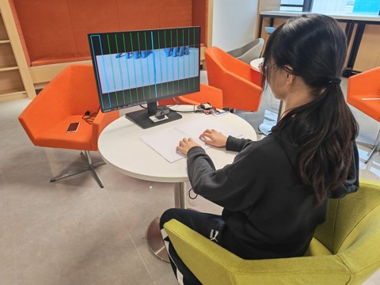
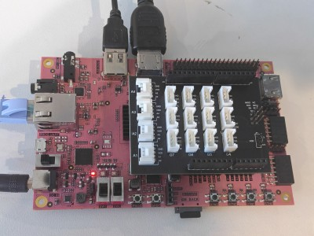
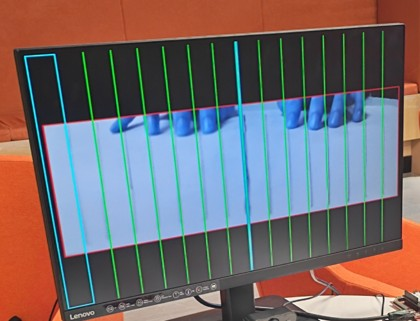

空气钢琴 AirKeys
基于PYNQ-Z2的非接触式手势演奏系统

系统实物全局图

一、摘要

本作品“空气钢琴”（AirKeys）以PYNQ-Z2为视觉计算核心，以一张打印纸为琴键，实现无需接触实体的十六键演奏。
系统由USB摄像头俯拍纸面，板端PS通过V4L2单帧缓冲采集320x240、30fps图像，依次完成ROI四边形掩膜、Gamma增强、高斯滤波、帧差阈值与开运算，再以NumPy切片统计16列运动像素。
随后将16列划分为0-7与8-15两个独立检测区，各区在运动质心序列上比较相邻帧的垂直位移dy与水平漂移dx，满足dy大于0.8且dy乘1.5大于dx时判定为“手指下压”，并通过UDP发送“列号,dy”报文。
PC端以NumPy按分波配方合成钢琴与八音盒两种正弦叠加音色，把dy连续映射为0.1到1.0的力度，采用“每音一线程、声部列表、声卡回调逐块混音”的架构，使双手同时按下时可真实并发两音。整机音域B2到C5，端到端延迟60到90毫秒，ROI外误触发为零。

二、功能与特性
1. 十六键非接触演奏：纸面16列对应B2~C5十六个音，中央C位于第9格（列号8）；手指悬停即静音，只有下压才触碰。
2. 力度与轻重：板端把下压位移dy随报文发送，PC端映射为0.1~1.0的连续力度，按得深则响、按得浅则轻。
3. 双手和弦：16列划分为0-7与8-15两个独立检测区，各区各自维护质心与列锁，同一帧可发两音，形成左右手和弦。
4. 双音色实时切换：钢琴音（基音+低次谐波、长尾）与八音盒音（高次谐波、短促），运行中按1/2键即可切换。
5. 可视化回显：HDMI实时叠加ROI蓝框、左右分区中线、16条绿色列线、黄框（当前最活跃列）与红框（刚发声列），便于现场标定与演示。
6. 强抗干扰：四边形ROI之外画面被涂黑，框外挥手、人员经过、桌面晃动均不会触发。

三、应用领域
1. 音乐教育与启蒙：无需购置钢琴，一张打印纸即可演示音阶、节奏与和弦，适合中小学音乐课堂与特殊教育场景。
2. 公共空间互动装置：科技馆、展会、商场中庭的“空气琴”互动墙，成本低、免维护，曲目与外观可随时更换。
3. 康复与无障碍：无需发力按压实体键，只需小幅下压动作，可用于手部康复训练与行动不便人群的音乐表达。
4. 舞台与新媒体艺术：纸面可替换为投影图案，配合灯光形成“手势即乐器”的演出形式。
5. 嵌入式视觉教学：以PYNQ-Z2为载体，完整呈现“采集—预处理—运动检测—网络通信—实时合成”链路，可作为SoC视觉课程的综合案例。

四、主要性能指标
整机主要指标如下（室内自然光、摄像头距纸面约400mm）：
1. 识别键数/音域：16键，B2~C5（中央C列号8）
2. 图像采集：USB 2.0 UVC，320×240@30 fps
3. 显示输出：HDMI 640×480@60 Hz，24 bit
4. 端到端延迟：典型60~90 ms
5. 力度范围：连续0.1~1.0（由dy映射）
6. 同时发声：同帧2音（左右各1）
7. 抗干扰：ROI外0次误触发
8. 音色：钢琴/八音盒，可切换

五、系统实物展示

六、运行指南
1. 板子端（PYNQ-Z2）：将code/board_airkeys.py传入板子Jupyter并运行。注意：务必先开启显示器，再给板子上电（以读取HDMI的EDID）。
2. 电脑端（PC发声）：运行code/pc_sound_synth.py。需将电脑IP设为192.168.2.2，并确保UDP 5005端口未被占用。

七、踩坑心得（摘自开发者报告）
1. HDMI黑屏：PYNQ的HDMI输出要读取显示器EDID，必须“显示器先开机、板子后上电”；固定为640×480后兼容性最好。
2. 环境光自激：摄像头自动曝光会让整幅画面缓慢变亮变暗，帧差结果整片泛白，系统“自激”式乱响。我们关掉自动白平衡、固定曝光，先做Gamma0.45提亮再帧差配合3×3开运算，静止时才真正安静。
3. 掩膜尺寸崩溃：程序反复报bitwise_and的sameSize断言错误，查了很久才发现摄像头实际输出的并不是设定的320×240，而掩膜是按320×240画的。加上“每帧统一resize+掩膜自适应resize”双保险后问题消失。
4. 和弦误触发：初版只有一把全局锁，发音后必须抬手才能再响，物理上就不可能同时弹出两个音；改成每列独立锁后能双音了，但左右横移又会误触发。最终我们把16列切成两个完全独立的检测器，各自维护质心历史与列锁，“左手动不干扰右手”，和弦才真正成立。
5. PC端音频失真：最初用墙钟时间戳定位混音读写指针，与声卡时钟漂移，越弹越糟，声音完全失真。改为“声部列表+回调逐块累加+20ms尾段渐隐”后声音立刻干净。为了不靠耳朵判断，用FFT测出C4的峰值在261.7Hz，误差小于1%，才确认音高正确。

八、开源协议
本项目采用 MIT License 协议。
